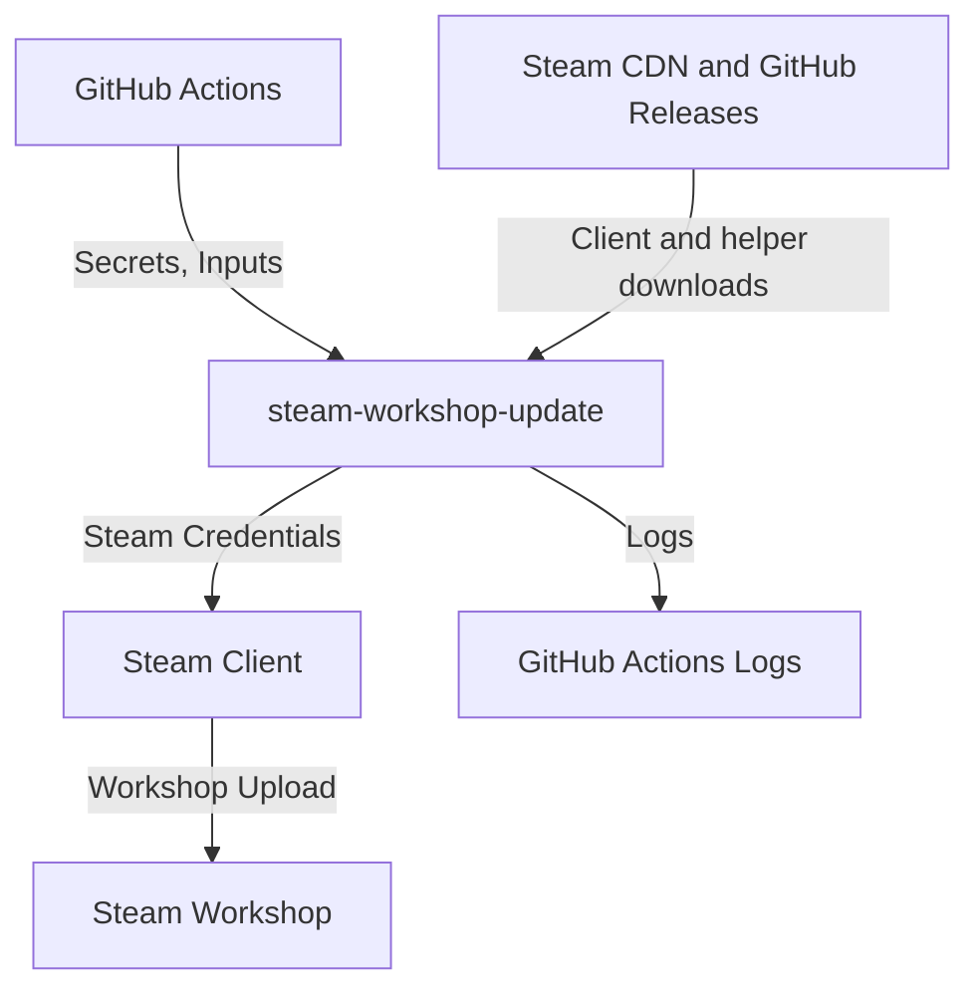
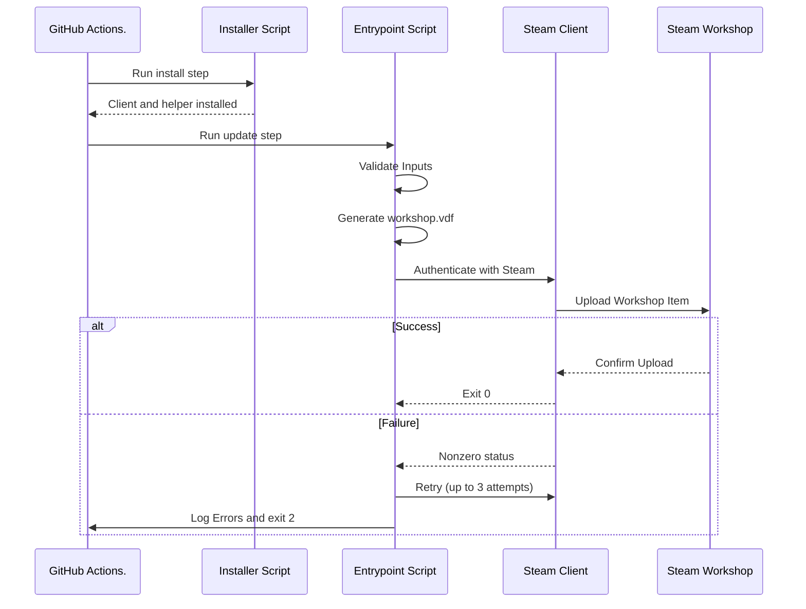
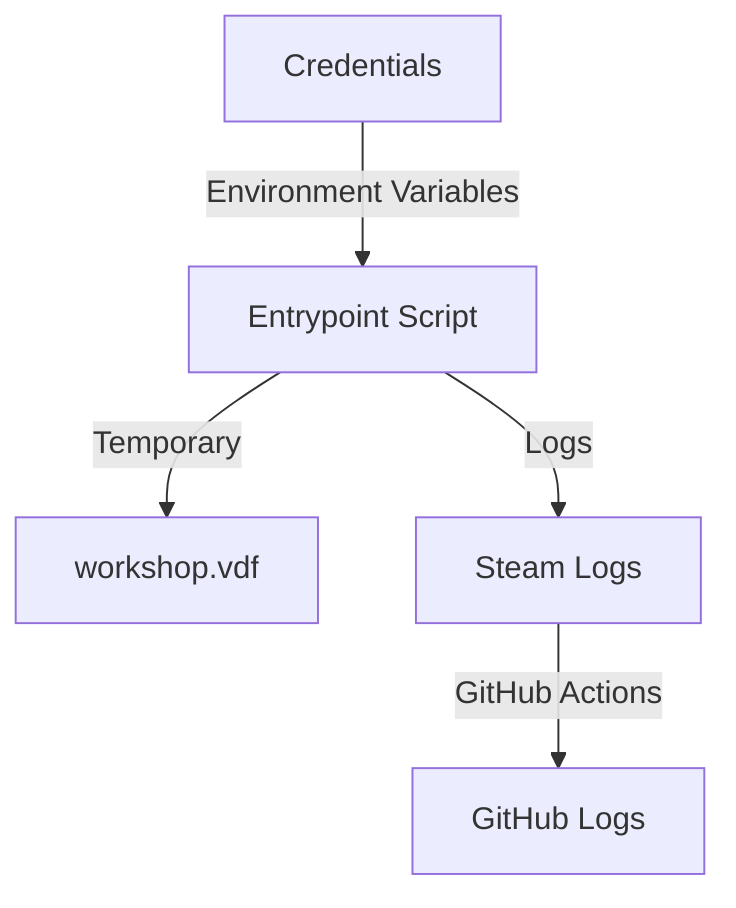

# Steam Workshop Update Architecture

This document describes the current architecture of the `steam-workshop-update` GitHub Action.

## 📑 Table of Contents

- [Purpose](#purpose)
- [System Context](#system-context)
- [Architectural Style](#architectural-style)
- [Runtime Flow](#runtime-flow)
- [Components](#components)
- [Data Architecture](#data-architecture)
- [Deployment and Operations](#deployment-and-operations)
- [Testing and Verification](#testing-and-verification)
- [Design Constraints](#design-constraints)
- [External Dependencies](#external-dependencies)

## 🎯 Purpose

The `steam-workshop-update` GitHub Action automates the process of updating a mod on the Steam Workshop. It supports Steam Guard two-factor authentication via a standard TOTP seed and retries the upload automatically on failure. This document outlines the architecture of the action, including its components, runtime flow, and deployment model.

## 🌐 System Context

The system operates within the GitHub Actions environment and interacts with:
- **GitHub Actions**: Provides secrets, inputs, and execution environment.
- **Steam Workshop API**: Authenticates and uploads content to the Steam Workshop.
- **Steam Client (`steamcmd`)**: Handles authentication and workshop upload operations.
- **Steam CDN and GitHub Releases**: Supply the SteamCMD archive and the `steam-totp` helper at install time.
- **User**: Configures workflows and provides credentials via GitHub Secrets.



## 🏗️ Architectural Style

The action is a **composite GitHub Action** consisting of two ordered runner steps: an installer that acquires SteamCMD and the TOTP helper, and a Bash entrypoint that orchestrates the upload. The style is a short-lived command pipeline; there is no server, container image, or long-running process.

The action previously ran inside a Docker container. GitHub's Ubuntu 26.04 runner image ships Docker 29.4.2, whose default seccomp profile denies `socketcall(2)`; the SteamCMD client is a 32-bit i386 binary that resolves names through `socketcall(2)`, so it could not reach Steam and reported `Steamcmd needs to be online to update`. Docker actions expose no `--security-opt` override, so the action now installs the client natively on the runner instead.

## 🔄 Runtime Flow

1. **Installation**: The runner executes `scripts/install-steamcmd.sh`, which ensures a 32-bit runtime, downloads Valve's SteamCMD archive, bootstraps the client, and downloads the `steam-totp` helper into `${STEAMCMD_ROOT}` (default `${RUNNER_TEMP}/steamcmd`).
2. **Validation**: The entrypoint script validates required environment variables (`STEAM_USERNAME`, `STEAM_PASSWORD`), requires an executable client, validates the inputs, and validates the content path and an explicitly requested preview image.
3. **Configuration**: A `workshop.vdf` file is generated with the provided inputs (`appid`, `itemid`, `path`, `changenote`, `icon`), including a `previewfile` field when a preview image applies.
4. **Authentication**: The script authenticates with Steam using `steamcmd`, optionally generating a 2FA code from the provided seed.
5. **Upload**: The action retries the workshop upload up to three times on failure.
6. **Completion**: On success, the action exits with status `0`. On failure, it prints the client logs and exits with status `2`.



## 🧩 Components

| Component | Responsibility | Principal Dependencies | Lifetime or Ownership |
|-----------|----------------|------------------------|-----------------------|
| Installer Script (`scripts/install-steamcmd.sh`) | Ensures a 32-bit runtime, downloads and bootstraps SteamCMD, downloads the TOTP helper. | `curl`/`wget`, `tar`, Steam CDN, GitHub Releases | Install step |
| Entrypoint Script (`entrypoint.sh`) | Validates inputs, generates configuration, and orchestrates the upload process. | `steamcmd`, `steam-totp` | Update step |
| Steam Client (`steamcmd`) | Handles authentication and workshop upload operations. | Steam Workshop API | Update step |
| Steam TOTP Tool (`steam-totp`) | Generates time-based one-time passwords for 2FA. | `STEAM_2FASEED` | Update step |
| Workshop VDF Configuration (`workshop.vdf`) | Stores workshop metadata for upload. | Entrypoint Script | Update step |

## 💾 Data Architecture

The action handles the following data:
- **Credentials**: `STEAM_USERNAME`, `STEAM_PASSWORD`, and `STEAM_2FASEED` (optional) are provided as environment variables and are not persisted.
- **Workshop Metadata**: Stored in a temporary `workshop.vdf` file under `${STEAMCMD_ROOT}`.
- **Logs**: Generated by `steamcmd` and persisted in `${STEAMCMD_HOME}/Steam/logs/` during execution.



| Data or Store | Owner | Representation and Storage | Lifecycle or Consistency |
|-----------|-------|----------------------------|--------------------------|
| Credentials | GitHub Actions | Environment variables | Job lifetime |
| Workshop Metadata | Entrypoint Script | `workshop.vdf` file | Job lifetime |
| Steam Logs | Steam Client | `${STEAMCMD_HOME}/Steam/logs/` | Job lifetime |

## 🚀 Deployment and Operations

The action runs as two composite steps inside the GitHub Actions environment, installing SteamCMD into the runner's temporary directory. The install directory is not explicitly removed afterwards, so operator cleanup policy applies to self-hosted runners. The action supports:
- **GitHub-Hosted Runners**: Provide the 32-bit runtime the client needs; Linux is required.
- **Self-Hosted Runners**: Require a 32-bit glibc runtime, either preinstalled or installable by the runtime user.

## 🧪 Testing and Verification

The action is tested via:
- **Unit Suite**: `tests/test_entrypoint.sh` exercises validation, redaction, TOTP shape, and the extracted retry loop.
- **Local Test Image**: [Dockerfile](./Dockerfile) mirrors the installer for local verification; GitHub Actions does not use it.
- **Manual Verification**: Integration runs against a disposable Workshop item use `tests/integration/`.

```bash
bash tests/test_entrypoint.sh
```

## 🛑 Design Constraints

- **No Persistent Storage**: The action does not persist data beyond the job lifetime, though the installed client and its Steam session remain under `${STEAMCMD_ROOT}` until the runner is discarded.
- **Mutable Client Download**: SteamCMD is fetched from an unpinned CDN URL; the helper URL carries a version but no integrity check.
- **Limited Retries**: Upload retries are capped at three attempts.
- **Steam API Dependencies**: The action relies on the Steam Workshop API and `steamcmd` for authentication and upload operations.

## 🔗 External Dependencies

| Dependency | Purpose | Version/Source |
|-----------|---------|------------------|
| GitHub Actions composite runner | Execution environment | GitHub-hosted or self-hosted Linux |
| 32-bit glibc runtime | Required by the i386 SteamCMD client | Preinstalled on hosted runners; `lib32gcc-s1` or `glibc.i686` otherwise |
| `steamcmd` | Steam authentication and workshop upload | Steam CDN archive, unpinned |
| `steam-totp` | Generates TOTP codes for 2FA | hmlendea/steam-totp v1.0.1 |
| Steam Workshop API | Workshop upload operations | Valve Corporation |

The action does not introduce additional external dependencies beyond those required for its core functionality.