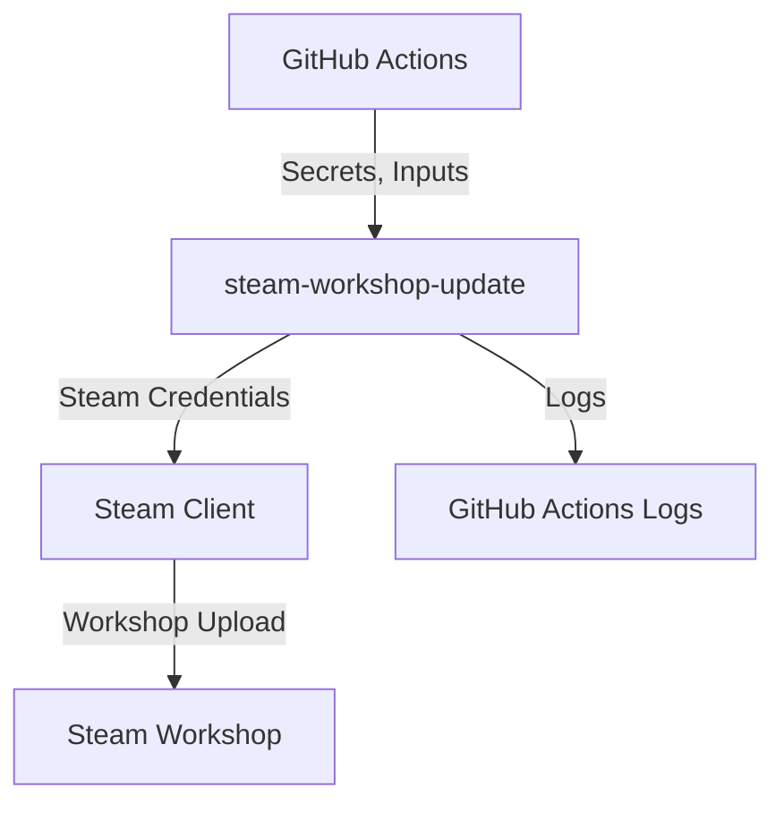
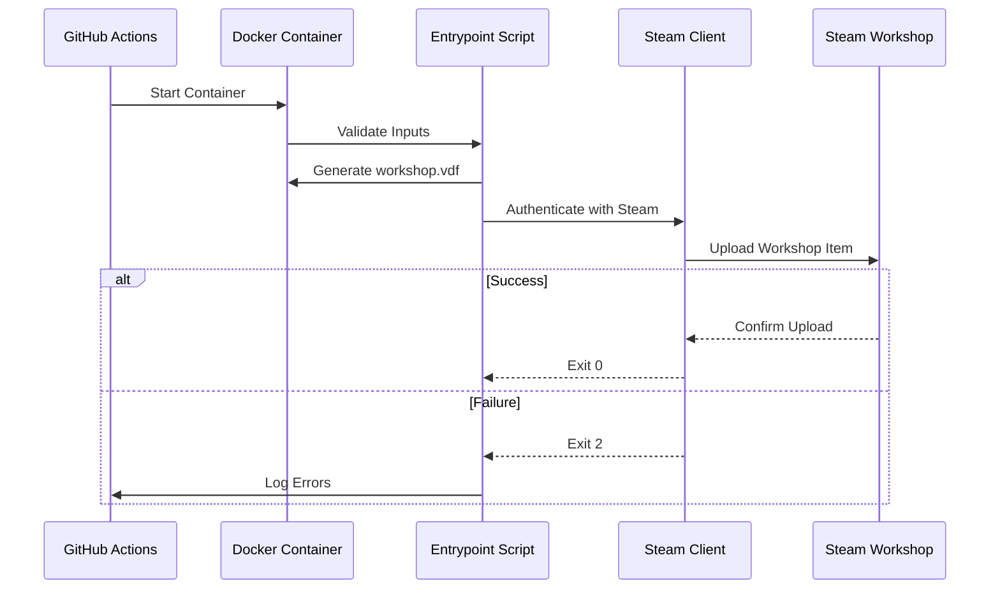
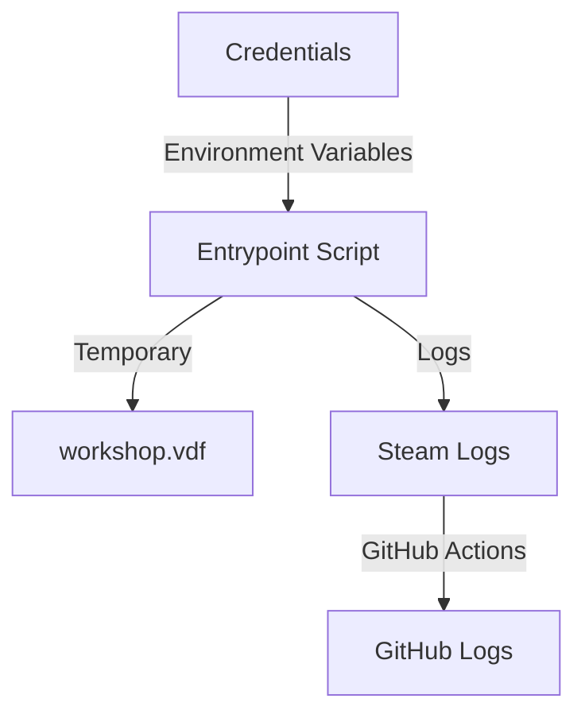

# Steam Workshop Update Architecture

This document describes the current architecture of the `steam-workshop-update` GitHub Action.

## 📑 Table of Contents

- [Purpose](#purpose)
- [System Context](#system-context)
- [Architectural Style](#architectural-style)
- [Runtime Flow](#runtime-flow)
- [Components](#components)
- [Data Architecture](#data-architecture)
- [Deployment and Operations](#deployment-and-operations)
- [Testing and Verification](#testing-and-verification)
- [Design Constraints](#design-constraints)
- [External Dependencies](#external-dependencies)

## 🎯 Purpose

The `steam-workshop-update` GitHub Action automates the process of updating a mod on the Steam Workshop. It supports Steam Guard two-factor authentication via a standard TOTP seed and retries the upload automatically on failure. This document outlines the architecture of the action, including its components, runtime flow, and deployment model.

## 🌐 System Context

The system operates within the GitHub Actions environment and interacts with:
- **GitHub Actions**: Provides secrets, inputs, and execution environment.
- **Steam Workshop API**: Authenticates and uploads content to the Steam Workshop.
- **Steam Client (`steamcmd`)**: Handles authentication and workshop upload operations.
- **User**: Configures workflows and provides credentials via GitHub Secrets.



## 🏗️ Architectural Style

The architecture follows a **containerised microservice** style, leveraging Docker to encapsulate the action's dependencies and runtime environment. The action is designed as a self-contained unit that interacts with external systems via well-defined interfaces.

## 🔄 Runtime Flow

1. **Initialisation**: The GitHub Actions runner starts the Docker container with the provided inputs and secrets.
2. **Validation**: The entrypoint script validates required environment variables (`STEAM_USERNAME`, `STEAM_PASSWORD`).
3. **Configuration**: A `workshop.vdf` file is generated with the provided inputs (`appid`, `itemid`, `path`, `changenote`).
4. **Authentication**: The script authenticates with Steam using `steamcmd`, optionally generating a 2FA code from the provided seed.
5. **Upload**: The action retries the workshop upload up to three times on failure.
6. **Completion**: On success, the action exits with status `0`. On failure, it logs errors and exits with status `2`.



## 🧩 Components

| Component | Responsibility | Principal Dependencies | Lifetime or Ownership |
|-----------|----------------|------------------------|-----------------------|
| Entrypoint Script (`entrypoint.sh`) | Validates inputs, generates configuration, and orchestrates the upload process. | `steamcmd`, `steam-totp` | Container lifetime |
| Steam Client (`steamcmd`) | Handles authentication and workshop upload operations. | Steam Workshop API | Container lifetime |
| Steam TOTP Tool (`steam-totp`) | Generates time-based one-time passwords for 2FA. | `STEAM_2FASEED` | Container lifetime |
| Workshop VDF Configuration (`workshop.vdf`) | Stores workshop metadata for upload. | Entrypoint Script | Container lifetime |

## 💾 Data Architecture

The action handles the following data:
- **Credentials**: `STEAM_USERNAME`, `STEAM_PASSWORD`, and `STEAM_2FASEED` (optional) are provided as environment variables and are not persisted.
- **Workshop Metadata**: Stored in a temporary `workshop.vdf` file within the container.
- **Logs**: Generated by `steamcmd` and persisted in `/home/steam/Steam/logs/` during execution.



| Data or Store | Owner | Representation and Storage | Lifecycle or Consistency |
|-----------|-------|----------------------------|--------------------------|
| Credentials | GitHub Actions | Environment variables | Job lifetime |
| Workshop Metadata | Entrypoint Script | `workshop.vdf` file | Job lifetime |
| Steam Logs | Steam Client | `/home/steam/Steam/logs/` | Job lifetime |

## 🚀 Deployment and Operations

The action is deployed as a Docker container and executed within the GitHub Actions environment. The container is ephemeral, and all data is cleaned up upon job completion. The action supports:
- **GitHub-Hosted Runners**: Executes in a pre-configured GitHub Actions environment.
- **Self-Hosted Runners**: Requires Docker to be installed and configured.

## 🧪 Testing and Verification

The action is tested via:
- **Docker Build and Run**: Validates the container and entrypoint script.
- **GitHub Actions Workflow**: Tests integration with the Steam Workshop API.
- **Manual Verification**: Logs and error handling are inspected for correctness.

```bash
# Build and run the container locally
docker build -t steam-workshop-update .
docker run --rm steam-workshop-update
```

## 🛑 Design Constraints

- **No Persistent Storage**: The action does not persist data beyond the job lifetime.
- **No External Dependencies**: All dependencies are bundled within the Docker image.
- **Limited Retries**: Upload retries are capped at three attempts.
- **Steam API Dependencies**: The action relies on the Steam Workshop API and `steamcmd` for authentication and upload operations.

## 🔗 External Dependencies

| Dependency | Purpose | Version/Source |
|-----------|---------|------------------|
| Docker | Container runtime | Bundled in GitHub Actions environment |
| `steamcmd` | Steam authentication and workshop upload | cm2network/steamcmd:root |
| `steam-totp` | Generates TOTP codes for 2FA | hmlendea/steam-totp |
| GitHub Actions | Execution environment | GitHub-hosted or self-hosted |
| Steam Workshop API | Workshop upload operations | Valve Corporation |

The action does not introduce additional external dependencies beyond those required for its core functionality.